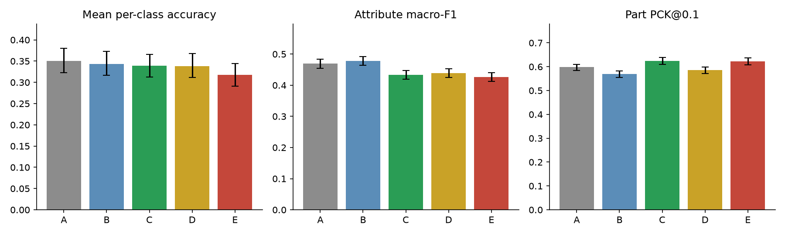

# Can domain knowledge guide visual evidence used in bird recognition?

EECS 442: Computer Vision · Fall 2026 project — Ziyi Wang, Haoping Wang, Jeffrey Huang, Yinuo Cao

We test whether short bird-guide identification notes help a **frozen** vision-language model
(Qwen3-VL-4B-Instruct) tell apart 20 visually similar CUB-200-2011 species, and whether the
notes also improve the *visual evidence* the model reports (attributes and part locations).

- 📄 Proposal: [`docs/proposal.md`](docs/proposal.md)
- 🗺️ Refined implementation plan (Chinese): [`docs/PLAN.md`](docs/PLAN.md)
- 📊 Results: [`results/RESULTS.md`](results/RESULTS.md)

## Design in one table

| Condition | Text added to the prompt | Purpose |
|---|---|---|
| A | nothing (image + 20 candidate species) | baseline |
| B | generic "inspect bill, crown, breast…" checklist | extra-instruction control |
| C | 4 visible field marks for **every** candidate species | main method |
| D | length-matched irrelevant sentences, same structure as C | text-length control |
| E | C with the first 2 features swapped within 5 similar-species pairs | misleading-text test |

Every response is one JSON object: 6 part locations (0–1000 relative coords), 24 CUB attributes
(yes / no / unclear) and a species ID. Metrics: mean per-class accuracy, attribute F1, part PCK@0.1,
with class-stratified paired bootstrap CIs. An occlusion experiment masks each species' key part vs.
an equal-area control region on 200 test images.

## Key findings (test split, 585 images × 5 conditions; full tables in [`results/RESULTS.md`](results/RESULTS.md))



1. **Correct notes do not improve species accuracy.** A 35.0% → C 33.9% (Δ −1.2 pp, 95% CI [−3.4, +1.1]);
   C is indistinguishable from length-matched irrelevant text (C − D = 0.0 pp). The generic checklist (B) is also null.
2. **Notes do change the reported evidence.** Part localization improves with species notes
   (PCK@0.1 +2.6 pp vs. A, +3.9 pp vs. D, both p < 0.001), but attribute macro-F1 *drops* (−3.6 pp) —
   and D drops it by the same amount, so the attribute loss is a long-prompt effect, not a knowledge effect.
3. **The model does read the notes.** Swapped notes (E) hurt accuracy significantly (E − A = −3.3 pp, p = 0.004;
   C − E = +2.1 pp, p = 0.006), mostly on the swapped species. Wrong text is more harmful than right text is helpful.
4. **Occlusion.** Masking the key part lowers accuracy more than masking a control region (A: 32.0 → 25.5% vs. 29.0%),
   but since C gives no gain over A to begin with, there is no knowledge gain to remove (Δ_ctrl − Δ_key = +0.5 pp, CI [−4.0, +5.0]).
5. **Supervised reference.** A linear probe on the *same frozen vision features* reaches **76.5%** —
   the visual information is there; zero-shot prompting (35%) fails to use it, with or without notes.

## Repository layout

```
configs/default.yaml        frozen inference config
knowledge/                  species notes (C), checklist (B), irrelevant pool (D), swap pairs (E)
data/splits/                species list, dev/val/test manifest, attribute set, occlusion subset
src/kgbr/
  cub.py                    CUB-200-2011 loader
  select_species.py         species selection rule + splits
  knowledge.py              condition texts, attribute selection, knowledge check
  prompts.py                prompt builder (identical across conditions except knowledge)
  model.py                  Qwen3-VL wrapper (greedy, pixel budget, batching, timing)
  parse.py                  robust JSON parsing
  run.py                    resumable batch inference -> results/raw/*.jsonl
  occlusion.py              occlusion subset and masks
  metrics.py                metrics + paired bootstrap
  analyze.py                tables and figures -> results/RESULTS.md
tests/                      unit tests (no GPU needed)
results/                    raw predictions (jsonl), RESULTS.md, figures
```

## Reproduce

Tested on Windows 11, RTX 5080 16 GB, Python 3.12, PyTorch 2.11 + CUDA 12.8, transformers 5.24.

```bash
# 1. environment (any CUDA-12.8+ PyTorch build that supports your GPU)
pip install torch torchvision --index-url https://download.pytorch.org/whl/cu128
pip install -e ".[dev]"

# 2. data: download CUB_200_2011.tgz from https://www.vision.caltech.edu/datasets/cub_200_2011/
export KGBR_CUB_ROOT=/path/to/CUB_200_2011        # PowerShell: $env:KGBR_CUB_ROOT="..."

# 3. fixed protocol (outputs are already committed in data/splits/)
python -m kgbr.select_species       # 20 species + dev/val/test split
python -m kgbr.knowledge            # attribute set + results/knowledge_check.md
python -m kgbr.occlusion            # 200-image occlusion subset
pytest                              # unit tests

# 4. experiments (the model downloads from Hugging Face on first use, ~9 GB)
python -m kgbr.run --split dev  --pilot --conditions A,C --tag pilot
python -m kgbr.run --split val  --conditions A,C --max-pixels 262144 --tag val_512
python -m kgbr.run --split val  --conditions A,C --max-pixels 589824 --tag val_768
python -m kgbr.run --split test --conditions A,B,C,D,E --tag main
python -m kgbr.run --split test --occlusion --conditions A,C --tag occlusion

# 5. analysis
python -m kgbr.analyze quick --tag val_512
python -m kgbr.analyze full         # writes results/RESULTS.md and results/figures/
```

Runs are resumable: re-running a command skips (image, condition, variant) triples already in
`results/raw/<tag>.jsonl`. Every record stores the image id, condition, prompt hash, config and
knowledge-file hashes, raw answer, parsed answer, token counts and latency.

## Data and licenses

CUB-200-2011 images are **not** redistributed here; download them from Caltech. Species notes are
our own paraphrases of field marks from the Cornell Lab of Ornithology's *All About Birds* guide
(source URL per species in `knowledge/species_notes.yaml`).

## References

1. S. Menon and C. Vondrick. Visual Classification via Description from Large Language Models. ICLR 2023.
2. Qwen Team. Qwen3-VL Technical Report. 2025.
3. C. Wah et al. The Caltech-UCSD Birds-200-2011 Dataset. Caltech, 2011.
4. Cornell Lab of Ornithology. All About Birds: Bird Guide.
