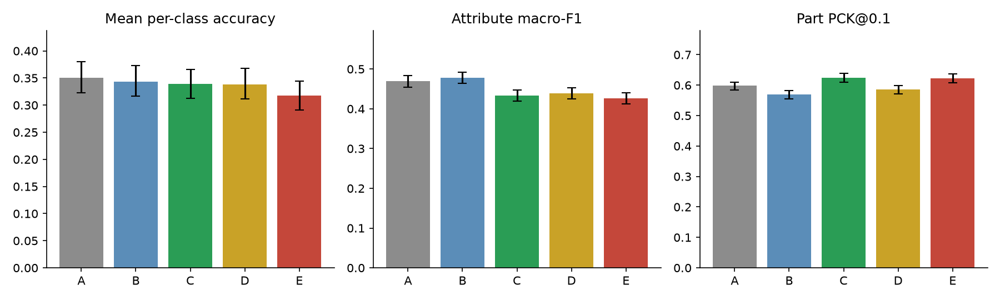
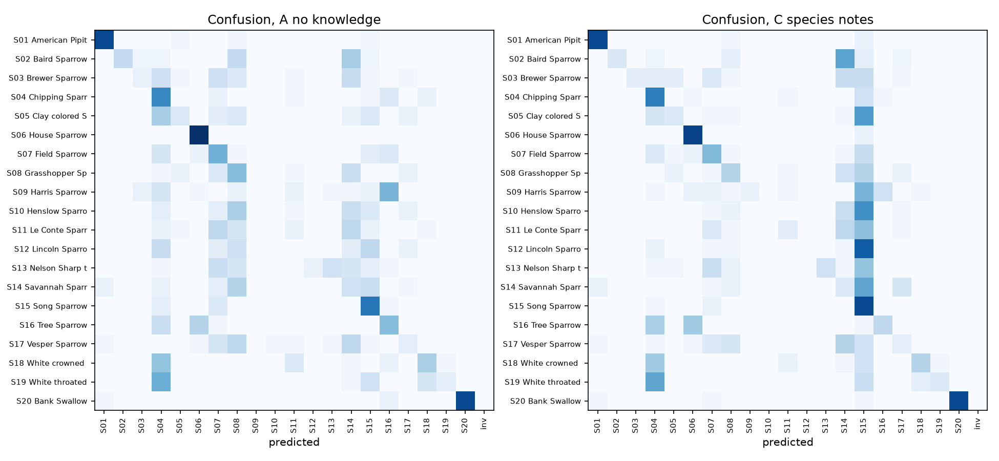
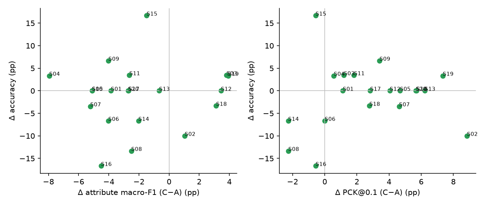
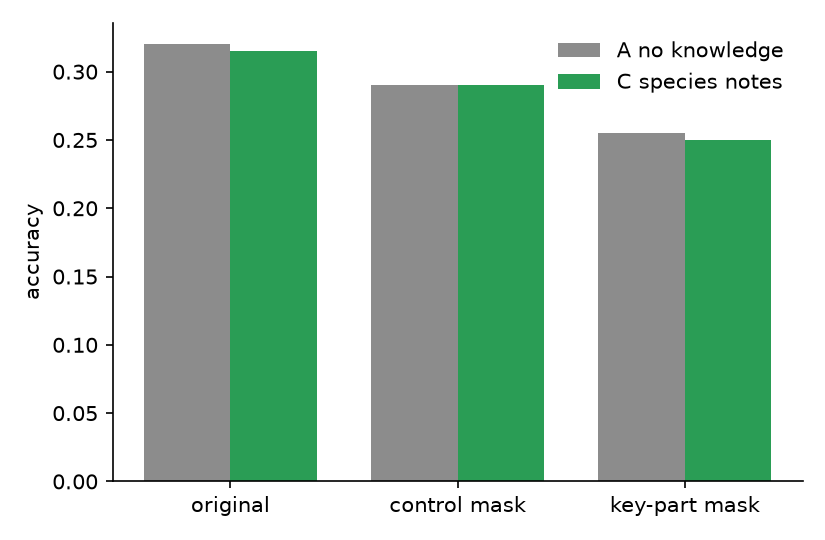
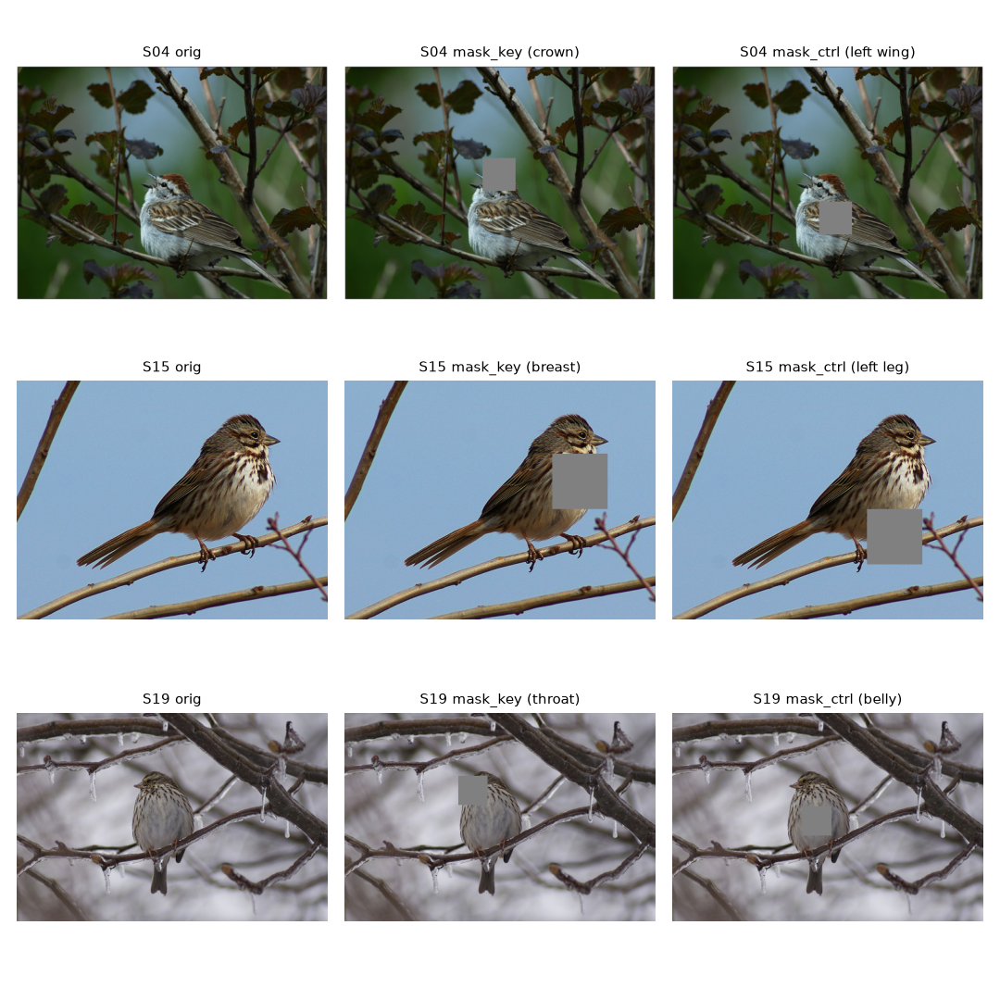
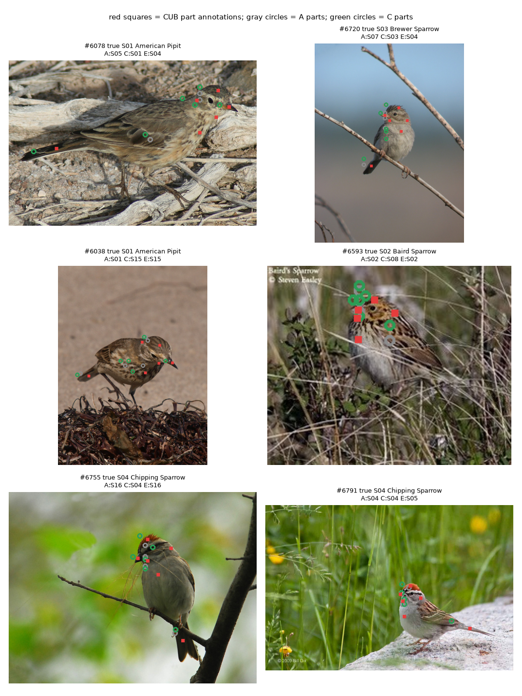

# Results

Generated by `python -m kgbr.analyze full`. Model: Qwen3-VL-4B-Instruct (frozen, greedy, bf16). Test split of the 20 selected species.

## 1. Main results (test split)

| Condition | n | Mean per-class acc % | 95% CI | Attr macro-F1 % | Attr micro-F1 % | Attr 'unclear' % | PCK@0.1 % | Part coverage % | Mean part err (x diag) |
|---|---|---|---|---|---|---|---|---|---|
| A no knowledge | 585 | 35.0 | [32.2, 38.1] | 47.0 | 52.0 | 0.0 | 59.8 | 100.0 | 0.096 |
| B generic checklist | 585 | 34.4 | [31.6, 37.3] | 47.8 | 54.1 | 0.0 | 57.0 | 100.0 | 0.100 |
| C species notes | 585 | 33.9 | [31.4, 36.7] | 43.4 | 53.6 | 0.0 | 62.4 | 100.0 | 0.097 |
| D irrelevant notes | 585 | 33.8 | [31.1, 36.8] | 43.9 | 49.4 | 0.0 | 58.6 | 100.0 | 0.098 |
| E swapped notes | 585 | 31.8 | [29.2, 34.4] | 42.7 | 53.2 | 0.0 | 62.2 | 100.0 | 0.097 |

Output reliability and cost:

| Condition | JSON fail % | Invalid species % | Truncated % | Input tokens | Output tokens | Sec / image (batch 8) |
|---|---|---|---|---|---|---|
| A no knowledge | 0.0 | 0.0 | 0.0 | 830 | 287 | 1.708 |
| B generic checklist | 0.0 | 0.0 | 0.0 | 932 | 284 | 1.515 |
| C species notes | 0.0 | 0.0 | 0.0 | 1830 | 288 | 1.753 |
| D irrelevant notes | 0.0 | 0.0 | 0.0 | 1789 | 288 | 1.648 |
| E swapped notes | 0.0 | 0.0 | 0.0 | 1830 | 288 | 1.707 |

## 2. Paired differences (stratified paired bootstrap, 2000 resamples)

| Comparison | Metric | Diff (pp) | 95% CI (pp) | p |
|---|---|---|---|---|
| B - A | acc | -0.7 | [-1.8, +0.5] | 0.304 |
| B - A | attr_macro_f1 | 0.8 | [-0.1, +1.7] | 0.084 |
| B - A | pck@0.1 | -2.8 | [-3.8, -1.9] | 0.000 |
| C - A | acc | -1.2 | [-3.4, +1.1] | 0.323 |
| C - A | attr_macro_f1 | -3.6 | [-5.1, -2.2] | 0.000 |
| C - A | pck@0.1 | 2.6 | [+1.3, +4.0] | 0.000 |
| D - A | acc | -1.2 | [-2.7, +0.3] | 0.087 |
| D - A | attr_macro_f1 | -3.1 | [-4.0, -2.3] | 0.000 |
| D - A | pck@0.1 | -1.2 | [-2.1, -0.4] | 0.007 |
| E - A | acc | -3.3 | [-5.6, -1.0] | 0.004 |
| E - A | attr_macro_f1 | -4.3 | [-5.8, -3.0] | 0.000 |
| E - A | pck@0.1 | 2.4 | [+1.1, +3.8] | 0.000 |
| C - B | acc | -0.5 | [-2.6, +1.7] | 0.663 |
| C - B | attr_macro_f1 | -4.4 | [-5.8, -3.1] | 0.000 |
| C - B | pck@0.1 | 5.5 | [+4.2, +6.7] | 0.000 |
| C - D | acc | 0.0 | [-2.2, +2.2] | 0.967 |
| C - D | attr_macro_f1 | -0.6 | [-2.0, +0.9] | 0.443 |
| C - D | pck@0.1 | 3.9 | [+2.5, +5.3] | 0.000 |
| C - E | acc | 2.1 | [+0.6, +3.7] | 0.006 |
| C - E | attr_macro_f1 | 0.7 | [-0.2, +1.6] | 0.114 |
| C - E | pck@0.1 | 0.2 | [-0.6, +1.1] | 0.643 |



## 3. Per-class accuracy (%)

|                                 |     A |    B |    C |     D |    E |
|:--------------------------------|------:|-----:|-----:|------:|-----:|
| S01 American Pipit              |  90   | 93.3 | 90   |  86.7 | 83.3 |
| S02 Baird Sparrow               |  25   | 25   | 15   |  25   | 20   |
| S03 Brewer Sparrow              |   6.9 |  6.9 | 10.3 |   6.9 |  6.9 |
| S04 Chipping Sparrow            |  66.7 | 60   | 70   |  66.7 | 66.7 |
| S05 Clay colored Sparrow        |  13.8 | 13.8 | 13.8 |   3.4 |  6.9 |
| S06 House Sparrow               | 100   | 96.7 | 93.3 | 100   | 93.3 |
| S07 Field Sparrow               |  48.3 | 48.3 | 44.8 |  41.4 | 44.8 |
| S08 Grasshopper Sparrow         |  43.3 | 46.7 | 30   |  43.3 | 33.3 |
| S09 Harris Sparrow              |   0   |  0   |  6.7 |   0   |  6.7 |
| S10 Henslow Sparrow             |   0   |  0   |  0   |   0   |  0   |
| S11 Le Conte Sparrow            |   6.9 |  6.9 | 10.3 |   6.9 | 10.3 |
| S12 Lincoln Sparrow             |   0   |  0   |  0   |   0   |  0   |
| S13 Nelson Sharp tailed Sparrow |  20   | 20   | 20   |  20   | 20   |
| S14 Savannah Sparrow            |  20   | 16.7 | 13.3 |  13.3 | 13.3 |
| S15 Song Sparrow                |  73.3 | 76.7 | 90   |  73.3 | 90   |
| S16 Tree Sparrow                |  43.3 | 40   | 26.7 |  43.3 | 26.7 |
| S17 Vesper Sparrow              |  10   |  6.7 | 10   |  10   |  6.7 |
| S18 White crowned Sparrow       |  33.3 | 30   | 30   |  33.3 | 10   |
| S19 White throated Sparrow      |  10   | 10   | 13.3 |  13.3 | 10   |
| S20 Bank Swallow                |  90   | 90   | 90   |  90   | 86.7 |



## 4. Does the classification gain go with better evidence? (per class, C vs A)

Spearman ρ(Δacc, Δattr-F1) = 0.13; ρ(Δacc, ΔPCK) = 0.13 (20 classes).



## 5. Misleading notes (condition E)

Swapped species = the 10 species in the 5 swapped pairs. `→ partner` = share of their images predicted as the pair partner whose features they were given.

| Condition | Acc swapped species % | Acc other species % | → partner % |
|---|---|---|---|
| A no knowledge | 25.6 | 45.5 | 11.1 |
| C species notes | 27.3 | 41.7 | 15.8 |
| E swapped notes | 23.6 | 41.0 | 15.5 |

## 6. Occlusion experiment (200 test images, 10 per class)

Knowledge gain Δ = acc(C) − acc(A) under each image condition. Masks are gray squares (side 0.30·√bbox area) on the species' key part vs. the nearest non-overlapping visible body part.

| Image | Acc A % | Acc C % | Δ = C−A (pp) | 95% CI |
|---|---|---|---|---|
| orig | 32.0 | 31.5 | -0.5 | [-4.5, +3.0] |
| mask_ctrl | 29.0 | 29.0 | 0.0 | [-4.0, +4.0] |
| mask_key | 25.5 | 25.0 | -0.5 | [-4.0, +2.5] |

**Δ_ctrl − Δ_key = +0.5 pp, 95% CI [-4.0, +5.0]** (positive = masking the key part removes more of the knowledge gain than masking a control region).





## 7. Cases (pre-defined categories; first two image ids in each)

- **A wrong → C right**: 22 images
- **A right → C wrong**: 28 images
- **C right → E wrong (swapped species)**: 12 images



## 8. Supervised reference: linear probe (uses training labels)

Mean-pooled frozen Qwen3-VL vision features + logistic regression, trained on dev (478 images), C chosen on val (best C = 30), evaluated once on test. **Not an equal-footing comparison** with the zero-shot prompting conditions above.

**Test mean per-class accuracy: 76.5%** (vs. 35.0% for zero-shot condition A).

## Run metadata

```json
{
  "config": {
    "model_id": "Qwen/Qwen3-VL-4B-Instruct",
    "revision": null,
    "dtype": "bfloat16",
    "load_in_4bit": false,
    "max_pixels": 262144,
    "max_new_tokens": 512,
    "batch_size": 8,
    "decoding": "greedy"
  },
  "config_hash": "c20e07f556",
  "knowledge_hash": "c5465e15c1",
  "model_revision": null,
  "torch": "2.11.0+cu128",
  "gpu": "NVIDIA GeForce RTX 5080",
  "python": "3.12.16",
  "platform": "Windows-11-10.0.26200-SP0",
  "peak_gpu_mem_gb": 12.47
}
```